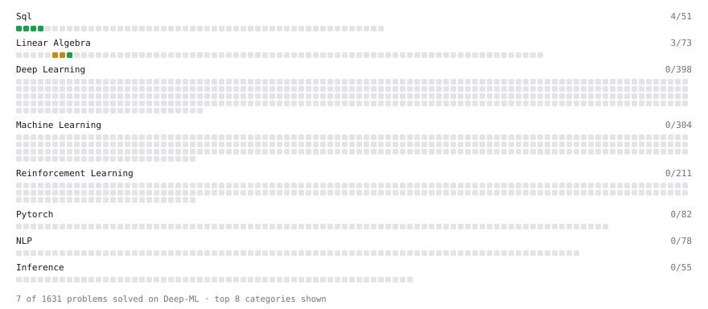

# Deep-ML

My machine learning practice from [Deep-ML](https://www.deep-ml.com). Every solution here was written by hand.

**3** solved · 3 problems · 0 labs · 0 math

[**Browse the interactive portfolio**](https://drizzy765.github.io/deep-ml/) to replay this filling in over time.

## Problems

| | Difficulty | Solved | |
| --- | --- | --- | --- |
| [Calculate 2x2 Matrix Inverse](https://www.deep-ml.com/problems/8) | easy | 2026-10-12 | [solution](problems/0008-calculate-2x2-matrix-inverse) |
| [SELECT all rows](https://www.deep-ml.com/problems/1101) | easy | 2026-10-10 | [solution](problems/1101-select-all-rows) |
| [Select specific columns](https://www.deep-ml.com/problems/1102) | easy | 2026-10-12 | [solution](problems/1102-select-specific-columns) |

---

_This file is regenerated by Deep-ML on every push._
